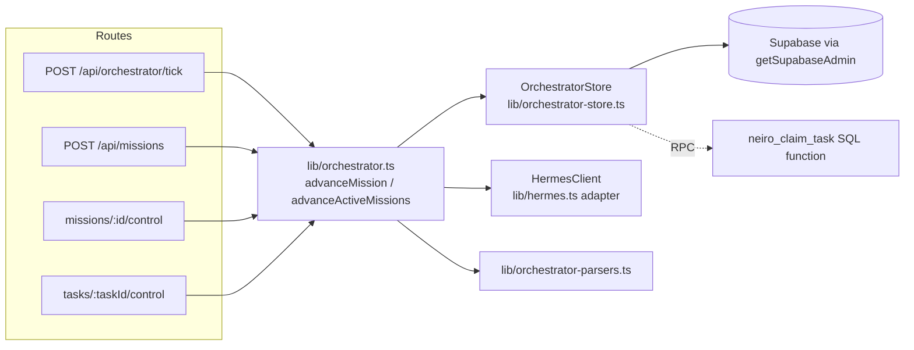
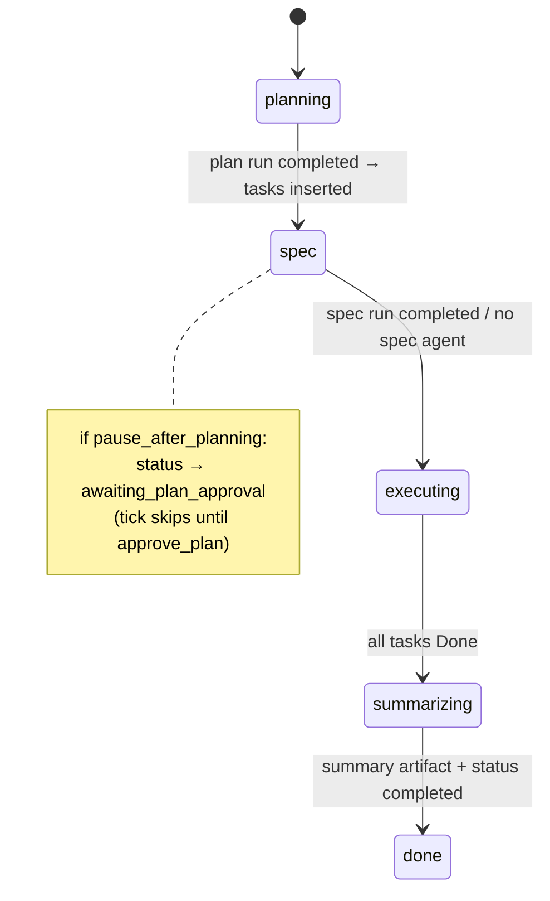
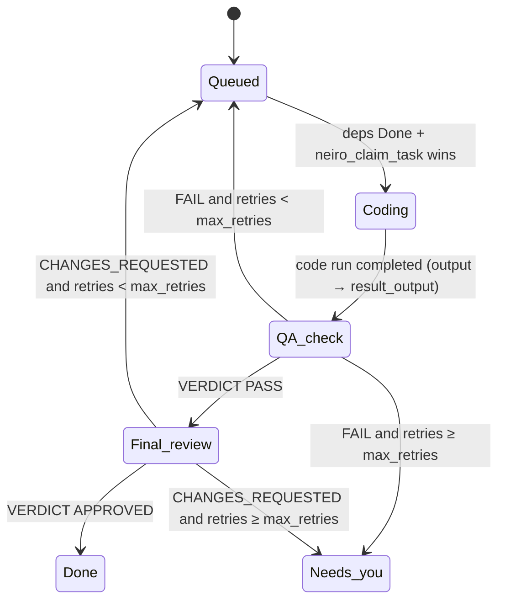

# Design — Fix review findings on PR #1

Implements `requirements.md` (R1–R12). Fixes land as new commits on `feat/phase-1-design-system` (D3), so [PR #1](https://github.com/julianreza/neiro/pull/1) updates in place.

## Overview

The core change is rewriting `lib/orchestrator.ts` from "do everything in one pass" into a small, poll-driven state machine:

- Every tick does at most one step per task/mission, and only after winning a guarded (compare-and-set) update. (R1)
- A stage starts a Hermes run and stores its `run_id`; a later tick polls it and transitions only when the run is terminal. (R2)
- Tasks carry the parser's `task_key`; dependencies resolve by key. (R3)
- Mission controls (`pause_after_planning`, `max_retries`, `max_parallel_workers`, `workspace_path`) are columns the engine reads. (R5, D1)
- Database and Hermes access go through two small injected interfaces, so the engine is unit-testable with in-memory fakes. (R12)

The remaining findings are local fixes: server-only admin client (R4), standard `cn` (R6), honest data-source badges (R7, D2), testable proxy exemption (R8), DTO contract (R9), docs (R10), logged + stored errors (R11).

## Architecture



### New / changed modules

| File | Change |
|---|---|
| `lib/orchestrator-store.ts` (new) | `OrchestratorStore` interface + `createSupabaseStore()` implementation |
| `lib/orchestrator.ts` | State machine rewritten against `OrchestratorStore` + `HermesClient`; `deps` parameter defaults to real implementations |
| `lib/orchestrator.test.ts` (new) | In-memory store + fake Hermes; regression tests R12.1–R12.5 |
| `lib/test-fakes/memory-store.ts`, `lib/test-fakes/fake-hermes.ts` (new) | Test doubles (not imported by app code) |
| `supabase/schema.sql` | Idempotent `ALTER … ADD COLUMN IF NOT EXISTS`, unique indexes, `neiro_claim_task` function |
| `lib/types.ts` | `Mission` / `MissionTask` / `MissionArtifact` new fields; `GatewayStatusDTO` full shape |
| `lib/supabase.ts` | Server-only key handling |
| `app/api/missions/route.ts` | Validate + persist controls; insert `running`; log errors |
| `app/api/missions/[id]/control/route.ts`, `…/tasks/[taskId]/control/route.ts` | Guarded `approve_plan`; `reportAdvanceError` instead of empty catch |
| `lib/utils.ts`, `package.json` | `clsx` + `tailwind-merge`; drop `cn`; add `server-only`; `test` script |
| `hooks/use-live-data.ts`, `components/data-source-badge.tsx` (new) | Loading / live / demo state + badge |
| `components/mission-workspace.tsx`, `agents-manager.tsx`, `schedules-manager.tsx`, `gateway-monitor.tsx` | Use `useLiveData`; no demo pre-fill; show `last_error` |
| `proxy.ts` | Exemption logic moved into exported `isExemptPath()` |
| `app/api/gateway/status/route.ts` | Response built as `GatewayStatusDTO` with `satisfies` |
| `README.md`, `NEIRO_ORCHESTRATOR_PLAN.md`, `.env.example` | Match shipped code |

## Data model changes (`supabase/schema.sql`)

Appended as an idempotent migration block so the file re-runs safely on an existing database.

```sql
-- missions: operator controls (R5), engine phase + run tracking (R1, R2), errors (R11)
ALTER TABLE missions ADD COLUMN IF NOT EXISTS pause_after_planning BOOLEAN NOT NULL DEFAULT false;
ALTER TABLE missions ADD COLUMN IF NOT EXISTS max_parallel_workers INT NOT NULL DEFAULT 3;
ALTER TABLE missions ADD COLUMN IF NOT EXISTS max_retries INT NOT NULL DEFAULT 2;
ALTER TABLE missions ADD COLUMN IF NOT EXISTS workspace_path TEXT;
ALTER TABLE missions ADD COLUMN IF NOT EXISTS phase TEXT NOT NULL DEFAULT 'planning';
ALTER TABLE missions ADD COLUMN IF NOT EXISTS run_id TEXT;
ALTER TABLE missions ADD COLUMN IF NOT EXISTS run_agent_id TEXT;
ALTER TABLE missions ADD COLUMN IF NOT EXISTS run_started_at TIMESTAMPTZ;
ALTER TABLE missions ADD COLUMN IF NOT EXISTS last_error TEXT;
ALTER TABLE missions ADD COLUMN IF NOT EXISTS last_error_at TIMESTAMPTZ;
-- CHECKs added via DO-block guarded on pg_constraint name:
--   missions_max_parallel_workers_chk  (max_parallel_workers BETWEEN 1 AND 10)
--   missions_max_retries_chk           (max_retries BETWEEN 0 AND 5)
--   missions_phase_chk                 (phase IN ('planning','spec','executing','summarizing','done'))

-- mission_tasks: DAG key (R3), run tracking (R2), coding output (R2.5)
ALTER TABLE mission_tasks ADD COLUMN IF NOT EXISTS task_key TEXT;
ALTER TABLE mission_tasks ADD COLUMN IF NOT EXISTS run_id TEXT;
ALTER TABLE mission_tasks ADD COLUMN IF NOT EXISTS run_agent_id TEXT;
ALTER TABLE mission_tasks ADD COLUMN IF NOT EXISTS run_started_at TIMESTAMPTZ;
ALTER TABLE mission_tasks ADD COLUMN IF NOT EXISTS result_output TEXT;
CREATE UNIQUE INDEX IF NOT EXISTS uq_mission_tasks_key
  ON mission_tasks(mission_id, task_key) WHERE task_key IS NOT NULL;

-- mission_artifacts: idempotent inserts (R1.4)
ALTER TABLE mission_artifacts ADD COLUMN IF NOT EXISTS dedupe_key TEXT;
CREATE UNIQUE INDEX IF NOT EXISTS uq_mission_artifacts_dedupe
  ON mission_artifacts(dedupe_key);
```

`dedupe_key` values: `plan:<missionId>`, `prd:<missionId>`, `summary:<missionId>`, `qa:<taskId>:<retries>`, `review:<taskId>:<retries>`. Inserts use `upsert(row, { onConflict: "dedupe_key", ignoreDuplicates: true })`. Postgres allows many `NULL`s in a unique index, so legacy rows are unaffected.

### `neiro_claim_task` (R1.2, R5.7)

The parallel-worker cap needs "count running tasks + claim one" to be atomic across ticks. Two plain guarded updates on different rows cannot do that under READ COMMITTED, so the claim is one SQL function serialized per mission with a transaction-scoped advisory lock:

```sql
CREATE OR REPLACE FUNCTION neiro_claim_task(p_task_id TEXT, p_token TEXT)
RETURNS BOOLEAN LANGUAGE plpgsql AS $$
DECLARE v_mission TEXT; v_max INT; v_active INT; v_rows INT;
BEGIN
  SELECT t.mission_id, m.max_parallel_workers INTO v_mission, v_max
    FROM mission_tasks t JOIN missions m ON m.id = t.mission_id
   WHERE t.id = p_task_id;
  IF v_mission IS NULL THEN RETURN false; END IF;
  PERFORM pg_advisory_xact_lock(hashtext(v_mission));
  SELECT count(*) INTO v_active FROM mission_tasks
   WHERE mission_id = v_mission
     AND (stage IN ('Coding','QA check','Final review') OR run_id IS NOT NULL);
  IF v_active >= v_max THEN RETURN false; END IF;
  UPDATE mission_tasks
     SET stage = 'Coding', run_id = p_token, run_started_at = NOW(), updated_at = NOW()
   WHERE id = p_task_id AND stage = 'Queued' AND run_id IS NULL;
  GET DIAGNOSTICS v_rows = ROW_COUNT;
  RETURN v_rows = 1;
END $$;
REVOKE ALL ON FUNCTION neiro_claim_task(TEXT, TEXT) FROM PUBLIC, anon, authenticated;
```

The `REVOKE` keeps it callable only by the service role, matching the zero-policy RLS model.

## Interfaces

```ts
// lib/orchestrator-store.ts
export type TaskGuard = { stage: TaskStage; runId: string | null };
export type MissionGuard = { phase: MissionPhase; runId: string | null; status?: MissionStatus };

export interface OrchestratorStore {
  getMissionDetail(missionId: string): Promise<MissionDetailDTO>;
  listActiveMissionIds(): Promise<string[]>;                         // status = 'running' only (R5.4)
  listEnabledAgents(stage: AgentStage): Promise<Agent[]>;
  /** Guarded update; true only if exactly one row matched the guard. */
  updateMissionIf(id: string, guard: MissionGuard, patch: MissionPatch): Promise<boolean>;
  updateTaskIf(id: string, guard: TaskGuard, patch: TaskPatch): Promise<boolean>;
  claimTask(taskId: string, token: string): Promise<boolean>;        // rpc neiro_claim_task
  insertTasks(rows: NewTaskRow[]): Promise<void>;                    // upsert on (mission_id, task_key), ignore dupes
  insertArtifactOnce(row: NewArtifactRow & { dedupeKey: string }): Promise<void>;
  setMissionError(id: string, message: string | null): Promise<void>;
}

// lib/orchestrator.ts
export interface HermesClient {
  startRun: typeof startHermesRun;
  getRun: typeof getHermesRun;
  createSession: typeof createHermesSession;
}
export type OrchestratorDeps = { store: OrchestratorStore; hermes: HermesClient; now: () => Date };

export async function advanceMission(missionId: string, deps?: Partial<OrchestratorDeps>): Promise<MissionDetailDTO>;
export async function advanceActiveMissions(deps?: Partial<OrchestratorDeps>): Promise<AdvanceActiveMissionsResult>;
export async function reportAdvanceError(missionId: string, err: unknown, taskId?: string, deps?: Partial<OrchestratorDeps>): Promise<void>;
```

Guards translate to Supabase as `.eq("id", id).eq("stage", g.stage)` plus `.eq("run_id", g.runId)` or `.is("run_id", null)`, then `.select("id")` and check `data.length === 1`.

`now` is injected so stale-claim timeouts are testable without real clocks.

## State machine

### Mission phases (mission-level runs)



One mission-level step per tick, chosen by `phase` and `run_id`:

1. `run_id` is null → **start**: claim with `updateMissionIf({phase, runId: null}, {run_id: "claim:<uuid>", run_started_at})`. Lost claim → return. Won → `startRun` with idempotency key `<phase>-<missionId>`. `deferred` → release claim (`run_id` back to null, guarded on the claim token). `started` → replace token with real `run_id` (guarded on token).
2. `run_id` is a real id → **poll** with `getRun`. Not terminal → return. Terminal → handle, then advance `phase` and clear `run_id` guarded on `{phase, runId}`.
3. Stale claim: `run_id` starts with `claim:` and `run_started_at` older than 5 minutes → release (covers a crash between claim and start; the Hermes idempotency key prevents a duplicate run on retry).

Planning completion (R2.4, R3):
- `status === "completed"` and non-empty output → `extractPlanFromOrchestratorOutput` → drop `dependsOn` keys not in the plan → `insertTasks` with `task_key = taskKey` → `insertArtifactOnce(plan:<id>)` → phase `spec`.
- `failed` / `cancelled` / `expired_404` / empty output → `setMissionError`, clear `run_id`, stay in `planning` (next tick retries). No fallback plan is built from an empty string.

Spec completion → write `prd:<id>` artifact. Then the guarded update sets `phase = 'executing'` and, if `pause_after_planning`, also `status = 'awaiting_plan_approval'` (guard includes `status: 'running'`).

`summarizing` → `insertArtifactOnce(summary:<id>)` → `updateMissionIf({phase:'summarizing'}, {phase:'done', status:'completed'})`. (R1.6)

### Task stages (only while mission `status = 'running'` and `phase = 'executing'`)



`stage` now means "what is running now". Per task per tick:

| Stage | `run_id` | Step |
|---|---|---|
| `Queued` | null | If every `depends` key maps to a same-mission task with `stage = 'Done'` → `claimTask(id, "claim:<uuid>")`. Lost → skip. Won → start code run (`code-<id>-<retries>`, prompt includes `workspace_path` when set), swap token for `run_id`. `deferred` → reset to `Queued`/null guarded on token. |
| `Coding` / `QA check` / `Final review` | null | Pick stage agent (`workers` / `qa` / `reviewer`). No agent → skip that gate: guarded move to next stage. Otherwise claim + start, same pattern as missions (`qa-<id>-<retries>`, `review-<id>-<retries>`). |
| any active | `claim:*` stale | Release claim. |
| any active | real id | Poll. Not terminal → skip. Terminal → see below. |

Terminal handling (all updates guarded on `{stage, runId}`; a lost guard means another tick already did it, so stop):
- `Coding` completed with output → patch `result_output`, `tokens += run.tokens`, `stage = 'QA check'`, `run_id = null`.
- `QA check` / `Final review` completed → `insertArtifactOnce(qa|review:<id>:<retries>)`, parse with `extractGateVerdict`. Pass → next stage. Fail → retry rule.
- Any run `failed` / `cancelled` / `expired_404` / empty output → counts as a failed attempt → retry rule.
- Retry rule (R5.6): `retries < mission.max_retries` → `stage = 'Queued'`, `retries = retries + 1`, `run_id = null`; else `stage = 'Needs you'`, `run_id = null`. Because the guard includes the observed `run_id`, only one tick can apply it, so `retries` moves exactly once. (R1.5)

Dependency check (R3.2, R3.5): build `Map<task_key, stage>` for the mission; a dependency is satisfied only by an exact key with `Done`. Tasks with `task_key IS NULL` (rows created before this fix) and non-empty `depends` are treated as having no resolvable dependencies and are left `Queued`, with `last_error` noting "legacy task without task_key". This is safe and visible instead of guessing.

When every task is `Done` → guarded `phase: executing → summarizing`.

## API changes

### `POST /api/missions` (R5.2, R5.3)

Validation (400 with a field-specific message on failure):

| Field | Rule | Default |
|---|---|---|
| `prompt` | non-empty string | required |
| `title` | string | first 48 chars of prompt |
| `pause_after_planning` | boolean | `false` |
| `max_parallel_workers` | integer 1–10 | `3` |
| `max_retries` | integer 0–5 | `2` |
| `workspace_path` | string ≤ 500 chars, trimmed; empty → null | `null` |

Inserted with `status: 'running'`, `phase: 'planning'`. Pausing happens after spec, per the state machine.

### `missions/[id]/control`

- `approve_plan` → `update({status:'running'}).eq('id', id).eq('status','awaiting_plan_approval')`; 0 rows → 409 `{ error: "Mission is not awaiting plan approval" }`.
- All `advanceMission` catches → `await reportAdvanceError(id, err)`.

### `tasks/[taskId]/control`

`mark_done` / `retry` catches → `reportAdvanceError(missionId, err, taskId)`. `retry` resets `run_id = null` along with `stage = 'Queued'`.

### `reportAdvanceError` (R11)

```ts
console.error("[orchestrator] advance failed", { missionId, taskId, error: message });
await store.setMissionError(missionId, message.slice(0, 1000)); // also sets last_error_at
```

It never throws, so a failing log path cannot break the route response. `advanceMission` clears `last_error` at the end of a successful pass when it was set. `advanceActiveMissions` uses it in its per-mission catch.

## Security fixes

### Admin client (R4)

```ts
import "server-only";
export function getSupabaseAdmin(): SupabaseClient {
  if (process.env.NEXT_PUBLIC_SUPABASE_SERVICE_ROLE_KEY) {
    throw new AppConfigError("public_service_role_key",
      "NEXT_PUBLIC_SUPABASE_SERVICE_ROLE_KEY must not be set; use SUPABASE_SERVICE_ROLE_KEY.");
  }
  const url = process.env.SUPABASE_URL || process.env.NEXT_PUBLIC_SUPABASE_URL; // URL is not secret
  const key = process.env.SUPABASE_SERVICE_ROLE_KEY;
  if (!url || !key) throw new AppConfigError("missing_supabase_env", "…");
  …
}
```

`server-only` is added as a pinned dependency. Its default export throws outside a server bundle, so the test script runs with the React Server condition: `"test": "bun test --conditions=react-server"`. That condition resolves `server-only` to its empty module. If the installed Bun rejects `--conditions` for `bun test`, the fallback is a `bunfig.toml` `[test]` preload that registers a no-op `server-only` module. Task 1 verifies this.

### Proxy exemption (R8)

```ts
export const PUBLIC_SVGS = new Set(["/file.svg", "/globe.svg", "/next.svg", "/vercel.svg", "/window.svg"]);
export function isExemptPath(pathname: string): boolean {
  return pathname === "/login" || pathname.startsWith("/api/auth") || PUBLIC_SVGS.has(pathname);
}
export const config = { matcher: ["/((?!_next/static|_next/image|favicon.ico).*)"] };
```

The exemption list is now code that `proxy()` calls and a unit test covers. The matcher no longer skips `*.svg`. `/api/x.svg` reaches `isAuthorizedRequest` and gets 401. The five SVGs are the files currently in `public/`.

## UI — honest data source (R7, D2)

```ts
// hooks/use-live-data.ts
type LiveState<T> =
  | { source: "loading" }
  | { source: "live"; data: T }
  | { source: "demo"; data: T; reason: string };
export function useLiveData<T>(url: string, demo: T, parse: (json: unknown) => T): LiveState<T> & { reload(): void };
```

- Starts as `loading`. Each surface renders its existing `Skeleton` components.
- OK response → `live`, rendered as-is (empty arrays show the existing empty states).
- Error → `demo` with `reason`: `"Supabase not configured"` for 503 `missing_supabase_env`, otherwise `"API error <status>"` / `"Network error"`.
- `components/data-source-badge.tsx` renders `<Badge role="status">Demo data — {reason}</Badge>` with visible text, plus an icon so it does not rely on color. It renders nothing for `live`.
- `mission-workspace.tsx`: `selectedId` starts as `null` and is set to the first mission once data arrives (it no longer reads `initialMissions[0].id`). It shows `last_error` as an `Alert` on the selected mission and `awaiting_plan_approval` with the existing Approve control.
- `agents-manager.tsx`: the hard-coded "Demo workspace… No requests are sent…" copy shows only when `source === "demo"`.
- `gateway-monitor.tsx`: status and models go through `useLiveData`. Its parse function is typed as `GatewayStatusDTO`.
- Optimistic mutations (create/edit/delete) stay as they are. In `demo` mode they are disabled with a tooltip, so nobody "saves" sample data.

## Contract fix (R9)

`lib/types.ts` gains:

```ts
export type GatewayCronStatus = { lastTickAt: string | null; stale: boolean };
export type AgentHealth = { id: string; name: string; status: GatewayServiceStatus["status"]; latencyMs?: number; error?: string };
export type GatewayStatusDTO = {
  configured: { supabase: boolean; hermes: boolean; nineRouter: boolean };
  cron: GatewayCronStatus;
  supabase: GatewayServiceStatus;
  hermes: GatewayServiceStatus;
  nineRouter: GatewayServiceStatus;
  defaultHermes: GatewayServiceStatus;
  agentsHealth: AgentHealth[];
  checkedAt: string;
};
```

The exact field shapes of `configured`, `cron` and `agentsHealth` are copied from what the route builds today, so the runtime shape does not change. The route returns `NextResponse.json(body satisfies GatewayStatusDTO)`.

## `cn` (R6)

```ts
import { clsx, type ClassValue } from "clsx";
import { twMerge } from "tailwind-merge";
export function cn(...inputs: ClassValue[]): string { return twMerge(clsx(inputs)); }
```

`bun remove cn && bun add --exact clsx tailwind-merge`. All existing `import { cn } from "@/lib/utils"` call sites stay unchanged.

## Docs (R10, R7.4)

- `NEIRO_ORCHESTRATOR_PLAN.md`: the schema section is rewritten to the post-fix `schema.sql`, and the state machine section to the diagrams above. Unbuilt items (`role_stage`, `system_prompt`, `custom_base_url`, `custom_api_key`, `hermes_profile`, extra mission statuses, `mission_artifacts.verdict`) move under "Planned — not in this PR".
- `README.md`: "The full backend engine is implemented" is replaced with a live-vs-demo table per surface, and env vars list only `SUPABASE_URL` + `SUPABASE_SERVICE_ROLE_KEY` for the server.
- `.env.example`: checked to contain no `NEXT_PUBLIC_*SERVICE_ROLE*`.
- PR #1 description: updated with `gh pr edit 1 --body-file` at the end, with the same live-vs-demo table. This writes to GitHub, so it runs only with the user's go-ahead during execution.

## Error handling

| Case | Behaviour |
|---|---|
| Hermes `deferred` (429/503) | Release claim; retry next tick; no attempt counted |
| Hermes start throws | Release claim; `reportAdvanceError`; no attempt counted |
| Run terminal non-success / empty output | Counts as a failed attempt (retry rule); planning stays in `planning` with `last_error` |
| Guarded update matches 0 rows | Treated as "already advanced"; stop processing that entity this tick |
| Stale `claim:*` > 5 min | Released on next tick |
| Supabase error inside store | Store throws → caller's catch → `reportAdvanceError` |
| `NEXT_PUBLIC_SUPABASE_SERVICE_ROLE_KEY` set | `AppConfigError` → routes return 503 with code |

## Testing strategy

Framework: the existing `node:test` + `node:assert/strict` style, run by `bun test` (`package.json` `test` script). There is no module mocking; the engine takes `deps`.

- `lib/test-fakes/memory-store.ts`: an in-memory `OrchestratorStore`. Every method `await`s a microtask before reading and writing, so two concurrent `advanceMission` calls really interleave at the same points as against Postgres. Each method body is atomic, like a single SQL statement. `claimTask` follows the SQL function's logic.
- `lib/test-fakes/fake-hermes.ts`: scripted runs. `startRun` records calls and dedupes by idempotency key, as Hermes does. Tests flip `getRun` from `running` to `completed` with set output.

`lib/orchestrator.test.ts` covers:
1. Concurrent `Promise.all([advanceMission(id), advanceMission(id)])` on a `Queued` task → one `startRun` call, one `Coding` transition, `retries` unchanged. (R12.1, R1.2)
2. Two concurrent ticks on a failed QA run → `retries` +1 exactly, one `qa_report`. (R1.4, R1.5)
3. Planning run `running` → no tasks; later `completed` → tasks inserted with `task_key`; two concurrent planning ticks → one task set, one `task_plan`. (R12.2, R1.3)
4. Planning run `completed` with empty output → no tasks, `last_error` set. (R2.4)
5. `T2 dependsOn T1` stays `Queued` until `T1` is `Done`; a task titled "Fix T1 bug" in `Done` does not satisfy it. (R12.3)
6. QA FAIL retries until `max_retries = 1`, then `Needs you`. (R12.4)
7. `pause_after_planning` → after spec: `awaiting_plan_approval`; `advanceActiveMissions` does not touch it; no code run starts. (R12.5)
8. `max_parallel_workers = 1` with two independent `Queued` tasks → only one enters `Coding`. (R5.7)

Other tests:
- `lib/auth.test.ts`: the existing Supabase env test is updated. Only `NEXT_PUBLIC_*` keys set → throws `missing_supabase_env`. `NEXT_PUBLIC_SUPABASE_SERVICE_ROLE_KEY` set → `public_service_role_key`. (R12.6)
- `lib/utils.test.ts`: `cn("p-2", "p-4") === "p-4"`. (R6.3)
- `proxy.test.ts` (new, repo root next to `proxy.ts`): `isExemptPath("/next.svg")` is true; `/api/x.svg` and `/missions/a.svg` are false. (R8)
- The `neiro_claim_task` SQL function is not executed in CI (there is no Postgres in the repo). Its logic is mirrored by the memory store and reviewed in the diff. Running `supabase/schema.sql` twice against a dev project is a manual check noted in the PR.

Verification gates (from `AGENTS.md`), run after each task where relevant and all at the end: `bun run lint`, `bunx next typegen && bunx tsc --noEmit`, `bun test`, `bun run build`. Host memory is currently low, so heavy gates (`build`) run once at the end and the other gates per task.

## Key decisions

| Decision | Choice | Why |
|---|---|---|
| Locking mechanism | Guarded updates + claim tokens; one SQL function only for the parallel cap | Supabase JS has no client transactions; guarded single-row updates are atomic. Only the count-then-claim step needs a lock. |
| Run tracking location | Columns on `missions` / `mission_tasks` | One active run per entity; no join table needed |
| Testability | Dependency injection (`deps`) | Avoids experimental module mocking; tests exercise real interleavings |
| `stage` semantics | "What is running now" | Removes the old Coding-starts-QA confusion (QA used to start before coding finished) |
| Legacy tasks without `task_key` | Leave `Queued`, surface `last_error` | No safe way to map old `T1` keys; visible beats guessing |
| Demo fallback | Kept, labelled, mutations disabled (D2) | Honest UI without losing offline preview |
