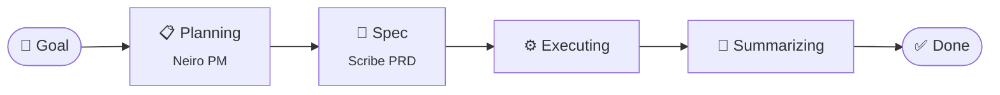
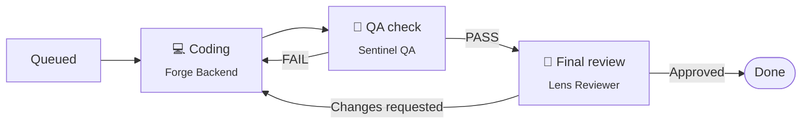
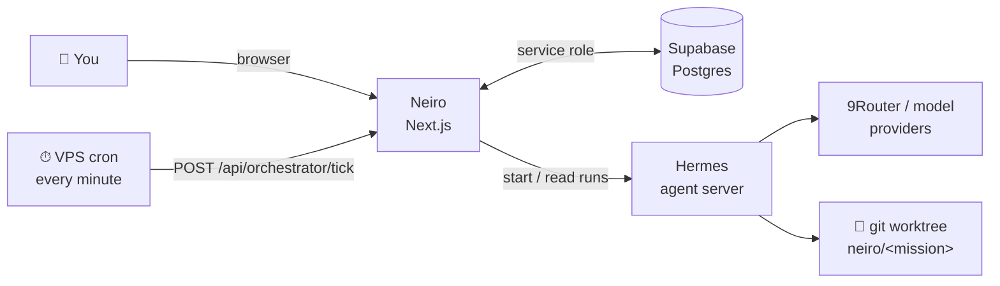

<div align="center">

# 🤖 Neiro

**Mission control for your AI dev team.**

Give Neiro a goal. A team of AI agents plans it, writes the spec, codes it, tests it, reviews it, and reports back.

[](https://github.com/julianreza/neiro/actions/workflows/ci.yml)


[Features](#-features) · [How it works](#-how-it-works) · [Quick start](#-quick-start) · [Configuration](#%EF%B8%8F-configuration) · [Architecture](#-architecture) · [Development](#-development)

</div>

---

## ✨ Features

| | |
| --- | --- |
| 🚀 **Missions** | Launch work in **Plan**, **Build** or **Fix** mode. Neiro breaks it into tasks and runs them to done. |
| 💬 **Ask mode** | Quick questions answered by the Q&A agent, saved to history. |
| 🏢 **AI team office** | A 3D virtual office. Each agent is a robot, and its motion shows its status. |
| 📄 **PRD review** | Read, approve or revise the spec before any code is written. |
| 🔍 **Live log** | Inspect every run step by step, copy output, allow or deny actions. |
| 🙋 **Needs you** | One inbox for everything waiting on a human. |
| 🌿 **Safe worktrees** | Agents work on their own git branch. Your checkout is never touched. |
| 🔎 **Code review** | Review any GitHub PR by URL. Build and Fix missions open a draft PR and land their Final review here too. |
| ⏰ **Schedules** | See the Hermes cron jobs that run your agents. |
| 💰 **Budgets** | Token budgets with notifications before you overspend. |
| 👥 **Users & roles** | Admin and viewer roles behind a signed session login. |
| 🎨 **Neumorphic UI** | Soft-depth surfaces, light and dark themes, reduced-motion aware. |

## 🧠 How it works

Every mission walks the same track:



Inside **Executing**, each task moves through its own stages:



### Meet the team

| Agent | Stage | Job |
| --- | --- | --- |
| 🧭 **Neiro PM** | Planning | Splits the goal into a task plan |
| ✍️ **Scribe PRD** | Spec | Writes the PRD, with versioned revisions |
| 🔨 **Forge Backend** | Coding | Writes the code in the mission worktree |
| 🛡️ **Sentinel QA** | QA check | Tests each task, PASS or FAIL |
| 🔎 **Lens Reviewer** | Final review | Approves or asks for changes |
| 📚 **Oracle Q&A** | Ask | Answers quick questions |

Agents are rows in the `agents` table. Add, edit, disable or swap their model from the **AI team** page. Changes apply on the next run, no restart needed.

## 🚀 Quick start

**Needs:** [Bun](https://bun.sh) 1.4+, a [Supabase](https://supabase.com) project, and a running Hermes agent server.

```bash
# 1. Install
bun install

# 2. Configure
cp .env.example .env.local   # then fill in the values

# 3. Create the database
bunx supabase login
bunx supabase link --project-ref <your-project-ref>
bun run db:push

# 4. Run
bun run dev
```

Open [http://localhost:3000](http://localhost:3000) and sign in with your `DASHBOARD_SECRET`.

> [!TIP]
> No Supabase CLI? Paste each file from `supabase/migrations/` into the Supabase SQL Editor, oldest first. Every migration is idempotent, so re-running one is safe.

## ⚙️ Configuration

All settings live in `.env.local`. See `.env.example` for the full list.

| Variable | Required | What it does |
| --- | :---: | --- |
| `DASHBOARD_SECRET` | ✅ | Login password and Bearer token for the tick endpoint. Min 8 chars (`openssl rand -hex 24`). |
| `SUPABASE_URL` | ✅ | Your Supabase project URL. |
| `SUPABASE_SERVICE_ROLE_KEY` | ✅ | Server-only service-role key. |
| `HERMES_DEFAULT_URL` | ✅ | Hermes agent server, e.g. `http://127.0.0.1:8642`. |
| `HERMES_DEFAULT_KEY` | ✅ | Hermes API key. |
| `HERMES_PROVIDER_SLUG` | | Force one provider. Empty uses each Hermes profile's own. |
| `NEIRO_ROUTER` | | `on` lets Laya pick the agent per task. `off` claims tasks directly. |
| `NEIRO_LAYA_MODEL_PATH` | | Local Laya model dir or Hugging Face repo id. Empty turns the router off. |
| `NEIRO_ROUTER_TIMEOUT_MS` | | Max time per routing decision. Default `5000`. |
| `NEIRO_LOCAL_TICK` | | `on` / `off`. Unset means on under `bun run dev`, off under `next start`. |
| `NEIRO_LOCAL_TICK_MS` | | Local tick interval. Default `15000`, minimum `5000`. |
| `NEIRO_WORKTREE_ROOT` | | Where mission worktrees go. Default `~/.neiro/worktrees`. |
| `NEIRO_TRUSTED_PROXY_HOPS` | | Trusted reverse proxies for the login limiter. Default `0`. |

> [!CAUTION]
> Never put the service-role key in a `NEXT_PUBLIC_*` variable. Next.js ships those to the browser. Neiro refuses to start the admin client if `NEXT_PUBLIC_SUPABASE_SERVICE_ROLE_KEY` is set.

## 🏗 Architecture



- **Orchestrator** (`lib/orchestrator.ts`): a poll-driven state machine. Each tick does at most one guarded step per mission and task. It starts Hermes runs and reads them on a later tick, resolves dependencies by `task_key`, and honours `pause_after_planning`, `max_retries` and `max_parallel_workers`. Overlapping ticks are safe. Errors land in `missions.last_error`.
- **Ticks**: in production, the cron in `deploy/neiro-tick.cron` calls `POST /api/orchestrator/tick`. Under `bun run dev` the server ticks itself every 15s (`instrumentation.ts` → `lib/local-ticker.ts`).
- **Task router** (`lib/task-router.ts`): Laya picks the best agent for each queued task. On timeout the default worker is used.
- **Auth** (`proxy.ts`, `lib/auth.ts`): every route is gated except `/login`, `/api/auth` and the public SVGs. Sessions are HMAC-SHA256 tokens. Failed logins are rate limited.
- **Database** (`supabase/migrations/`): RLS on, no public policies. Only the server-side service-role client reads or writes.
- **Integrations**: `lib/hermes.ts` is the Hermes client. Models, including 9Router ones, are listed through Hermes.

### 🌿 Worktrees

A mission's workspace folder must exist on the machine running Neiro and Hermes. If it is a git repo, Neiro creates a worktree on a new branch `neiro/<mission>` under `~/.neiro/worktrees/`. Coding, QA and Review all happen there.

To roll back, cancel the mission, then:

```bash
curl -X POST "$NEIRO_URL/api/missions/<id>/control" \
  -H "Content-Type: application/json" \
  -d '{"action":"discard_worktree"}'
```

This deletes the worktree and its branch.

### 🔎 Code review

The **Code review** page (`/reviews`) needs the GitHub CLI on the machine running Neiro, logged in once:

```bash
gh auth login
```

- **By PR**: paste `https://github.com/<owner>/<repo>/pull/<n>`. An enabled agent with the `reviewer` stage reads the diff and answers with a verdict, a design gate and findings. Nothing is posted to GitHub until you press **Post to GitHub**.
- **From missions**: in **Build** and **Fix** missions, each task commits its work, pushes `neiro/<mission>` to `origin` and opens (or reuses) one draft PR before its Final review. That review shows up on the page. If the PR cannot be opened (no `origin`, `gh` not logged in), the task goes to **Needs you** with the reason.
- Only `neiro/...` branches are ever pushed. Run `supabase/migrations/20261030000400_code_reviews.sql` and `20261030000500_code_review_design.sql` first.

### 🧪 Live vs demo data

Every page loads from its API first. If the API is down, it shows sample data with a visible **"Demo data — reason"** badge.

| Page | Live source | Writes when live | Demo fallback |
| --- | --- | --- | --- |
| Mission control | `/api/missions`, `/api/missions/:id` | Launch, approve plan, cancel, task controls | Sample missions, launch disabled |
| AI team | `/api/agents` | Create, edit, enable/disable, delete, restore starters | Sample agents, edits disabled |
| Schedules | `/api/schedules` (Hermes jobs) | None (manage jobs on Hermes) | Sample schedules |
| 9Router & VPS | `/api/gateway/status`, `/api/gateway/models` | None | Sample model catalog, health unknown |

## 📁 Project layout

```text
neiro/
├── app/
│   ├── (dashboard)/     # projects, missions, agents, chat, live, needs-you,
│   │                    # schedules, gateway, users
│   ├── api/             # route handlers (missions, agents, ask, orchestrator, …)
│   ├── login/           # neumorphic login page
│   └── globals.css      # Tailwind v4 theme tokens + neumorphism
├── components/          # UI (team-office, mission-workspace, live-log, …)
│   └── ui/              # shadcn/ui primitives
├── lib/                 # orchestrator, hermes, auth, router + *.test.ts
├── supabase/migrations/ # timestamped, idempotent SQL
├── deploy/              # production tick cron
├── vendor/laya-ts/      # bundled Laya task router
└── proxy.ts             # auth gate (Next.js 16 replaces middleware)
```

## 🛠 Development

| Command | What it does |
| --- | --- |
| `bun run dev` | Dev server with Turbopack on `localhost:3000` |
| `bun run build` | Production build |
| `bun run start` | Serve the production build |
| `bun run lint` | ESLint 9 |
| `bunx next typegen && bunx tsc --noEmit` | Typecheck |
| `bun run test` | Tests (`bun test --conditions=react-server`) |
| `bun run db:new <name>` | New migration file |
| `bun run db:push` | Apply migrations |

Run the full check before you push (CI runs the same steps):

```bash
bun run test && bunx next typegen && bunx tsc --noEmit && bun run lint && bun run build
```

> [!NOTE]
> Add schema changes as a new timestamped file. Never edit a migration that is already applied.

## 🚢 Deploy

1. Deploy the Next.js app (Vercel or any Node host) with the env vars above.
2. Apply the migrations to your Supabase project.
3. On your VPS, add `deploy/neiro-tick.cron` to `crontab -e`, with `NEIRO_URL` and `DASHBOARD_SECRET` set.

---

<div align="center">
<sub>Built with Next.js, Supabase and a crew of very busy robots 🤖</sub>
</div>
